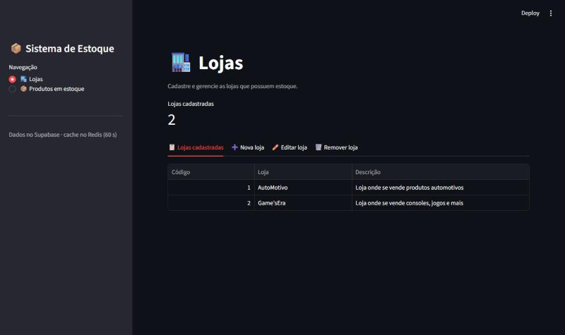
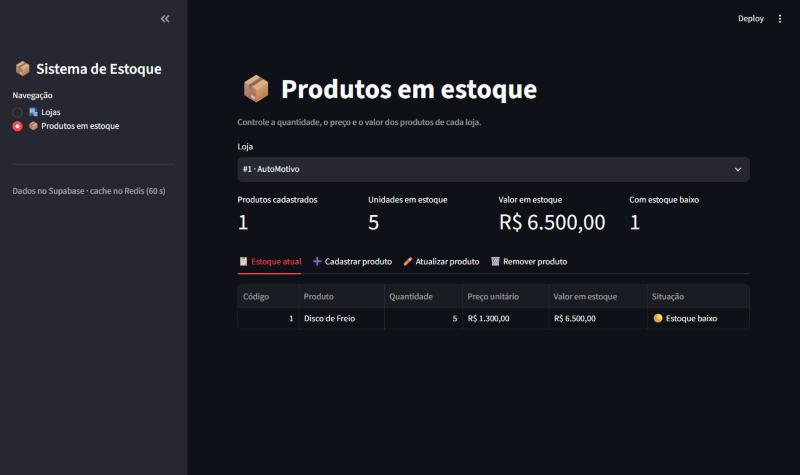

# 📦 Sistema de Estoque

Sistema para controlar o estoque de lojas. Ele substitui cadernos e planilhas soltas, nos quais é difícil saber quanto existe de cada produto e o que precisa de reposição.

## Objetivo e funcionalidades

Cadastrar lojas e produtos e acompanhar o estoque de cada loja.

- Cadastrar, listar, editar e remover lojas
- Cadastrar, listar, editar e remover produtos de cada loja
- Resumo do estoque: unidades, valor total em R$ e itens com estoque baixo

## Tecnologias

Python, Streamlit (interface), Supabase (banco de dados) e Redis (cache).

## Instalação e execução

```bash
pip install streamlit supabase redis pandas
```

Coloque a URL e a chave do Supabase e os dados de conexão do Redis no arquivo `Atividade_Supabase_Redis.py`. Depois rode:

```bash
streamlit run interface_streamlit.py
```

A aplicação abre em http://localhost:8501.

## Supabase

É o banco de dados do sistema. Guarda as tabelas `lojas` e `produtos`. Cada ação da tela (criar, listar, editar e remover) chama uma função que faz o `insert`, `select`, `update` ou `delete` correspondente no Supabase.

## Redis

**Onde:** nas funções `listar_lojas` e `listar_produtos`, em `Atividade_Supabase_Redis.py`.

**Como:** antes de consultar o Supabase, o sistema procura a lista no Redis. Se ela estiver lá, devolve direto. Se não estiver, busca no Supabase e guarda o resultado no Redis por 60 segundos. Quando uma loja ou um produto é criado, editado ou removido, o cache é apagado para a próxima consulta trazer os dados atualizados.

**Por quê:** o Streamlit recarrega a tela a cada clique, e cada recarga pediria as listas de novo ao Supabase. Com o Redis, as consultas repetidas saem da memória, o que deixa a tela mais rápida e reduz a carga no banco.

## Telas




